# Onboard Studio User Guide

Onboard Studio keeps a logbook of your track days, turns a lap video and the data recorded with it
into a video with gauges, a track map, lap timing and anything else you want drawn on top, and
then says where the time went and whether you are getting quicker. This guide follows a track day
round, from the files to the next visit:

| | What you do | Chapter |
| --- | --- | --- |
| 1 | Open the app and find your way | [Getting started](#1-getting-started) |
| 2 | Put a day's sessions, videos and car in the Logbook, in any order, and put mistakes right | [Your track days: the Logbook](#2-your-track-days-the-logbook) |
| 3 | Make a video with overlays | [Making a video](#3-making-a-video) |
| 4 | Find out where the time went, and what to try next time | [Being coached](#4-being-coached) |
| 5 | See whether you are getting quicker | [Your progress](#5-your-progress) |
| 6 | Before going back to a circuit: the plan and your goals | [Before you go back](#6-before-you-go-back) |
| 7 | The next day: bring it in, see how it went, make the new videos | [Coming back](#7-coming-back) |

[Command line](#8-command-line) and [Troubleshooting](#9-troubleshooting) close the guide. It
assumes nothing beyond having a video and, ideally, a data log.

## 1. Getting started

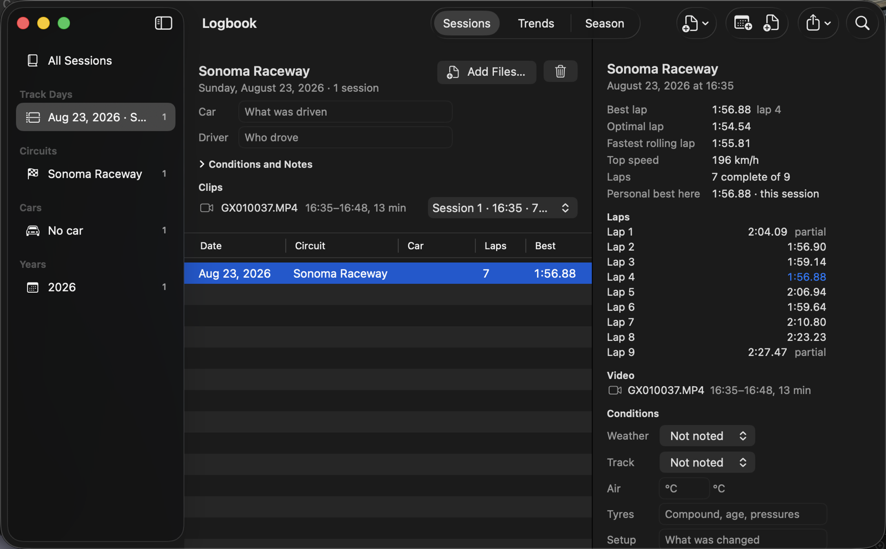

**Launch Onboard Studio** and the **Logbook** opens: every track day you have driven, with its
sessions and clips, and the way into everything else. It is three columns, as Mail is — track
days, circuits and cars on the left, a day's sessions in the middle, the chosen session on the
right.

The first time, the Logbook shows a three-step tour of its sidebar, its sessions and the session's
detail (**Help ▸ Take the Tour** repeats it while the Logbook is in front). While no session is
chosen, the detail column holds the Logbook's **Getting Started**: add a track day's files, say
what was driven, make a video of a session, be coached through a lap, see how you are getting on —
each ticked as you do it, with a button that does or shows it.

Untick *Open the Logbook at launch* in **Settings ▸ Logbook** to start on a blank project instead;
**Window ▸ Logbook** (⌃⌘L) brings it back. **Help ▸ Open the Sample Project** opens a short clip
with a synthetic log if you just want to poke around.

### From a track day to a video

1. **Begin the day.** **New Track Day…** in the toolbar (⌥⌘N): the date, the circuit, the car.
   ([Starting a day](#starting-a-day))
2. **Add its files.** **Add Files…**, or drop the logger's files and the camera's clips on the
   Logbook — a whole day's folder too. Each session is read, its laps timed and its circuit
   recognised, and each clip is matched to the session it filmed by the camera's clock. The sheet
   says what happened to every file, and how the day went against your last visit.
   ([Adding a day's files](#adding-a-days-files))
3. **Say what was driven** if the sheet asks: on a first import there is no car to take it from.
4. **Choose a session** in the table. Its detail lists its laps with the best marked, its clips,
   and at its foot what can be done with it.
5. **New Project** — the button at the foot of the detail, or the toolbar's menu, which names the
   session it will use — opens a project with the session's data, its clips and gauges already
   laid out, the data lined up with the video by the clocks in the files when they have them.
   ([Making a video](#3-making-a-video))
6. **Play** (Space) and scrub the timeline to check that the gauges follow the picture; if they
   lead or lag, open **Sync** and nudge.
7. **Export** (**⌘E**). Pick a range — your best lap is one choice — and a preset (1080p, 4K,
   vertical…), and press Export. **Upload to YouTube…** appears when it is done.

Then **Coach…** on the same session says where the time went ([Being coached](#4-being-coached)).

### Starting from files instead

The Logbook toolbar's **New Project** menu offers a **Blank Project**, a project **from a
template** (gauges already laid out, which attach themselves to the video and data files you add
next), **Open Project…** and the sample project. While a session is selected that menu's projects
are made from the session, and **New Project Without a Session** is the empty one. **File ▸ Open
Recent** has your recent projects. A new project opens with a welcome panel and, the first time, a
three-step tour (**Help ▸ Take the Tour** repeats it). Files can be dropped anywhere in the window.
A folder is not taken apart there — the status line says so: drop the files inside it, or enter
the folder in the Logbook, which is what takes a day's folder whole. A data file added to a project
goes into the Logbook as well ([Projects and the Logbook](#projects-and-the-logbook)). Then,
in the project:

1. **Add the video** (the big button, **⌘I**, or drop it in). If the file is the first chapter of
   a GoPro recording (`GX010037.MP4`, `GX020037.MP4`, …) Onboard Studio joins the following chapters
   so they play as one continuous video. Add a second recording the same way and it gets its own
   lane, starting where the previous video ends, with the pause between the two recordings kept
   (read from the camera's clock) so one data log stays lined up across both. Each recording has
   its own bar and its own row in the sidebar, so you can move, trim and rename it on its own. A
   file that is already in the project is not added twice. For a second camera to show picture-in-picture use **Project ▸ Add
   Camera…** (**⇧⌘I**), which opens a new lane.
2. **Add the data.** Either **Add Data File…** (**⇧⌘D**) with a RaceChrono export, GPX, FIT, CSV
   or similar, or, for a GoPro clip, select the video and press **Use Embedded GPS** to use the
   GPS, accelerometer and gyro the camera recorded. A DJI or Garmin log next to the clip appears as
   **Use Sidecar Data**.
3. **Line the data up with the video.** When the log has a clock (RaceChrono, GPX, FIT, DJI…)
   this happens automatically the moment the file is added; the status line says which clock was
   used. If the camera's clock is wrong — a GoPro with no GPS fix whose clock was never set
   reads days off — the clocks put the video outside the log, so Onboard Studio says how far
   apart they are and syncs by motion instead. Otherwise select the data input and press **Auto-Sync by Motion** (matches the video's
   sound and motion against the log's speed) or **Synchronize with Video…** for the manual panel.
4. **Add gauges.** **Project ▸ Apply Template ▸ Classic Dash** gives a speedometer, tachometer,
   track map, g-force plot and lap timer at once; **Add Object** adds them one by one. Drag objects
   on the preview to move them, drag the handles to resize, and tune them in the inspector on the
   right.
5. **Play** (space) and scrub the timeline to check that the gauges follow the picture. If they
   lead or lag, open **Sync** and nudge — the panel sits under the preview, so the picture stays
   visible and scrubbable while you work.
6. **Export** (**⌘E**). Pick a range first (whole project, a time span, your best lap or any run
   of laps), then a preset (1080p, 4K, vertical…), and press Export. **Upload to YouTube…** appears
   when it is done.

As soon as a project has a file in it, a bar above the preview says the next of these steps —
*Next step: Add gauges* — with the button that does it (*Apply the Classic Dash Template*), and
**Show All Steps** brings up the whole **Getting Started** checklist, first in the project's
inspector. Export is ticked once a video has been exported from the project. The bar's ✕ hides it
and the checklist, in projects and in the Logbook; **Help ▸ Show Getting Started** brings them
back.

## 2. Your track days: the Logbook

The app keeps a **logbook** of your track days and the sessions driven on them — which file, where
and when it was driven, the car, every lap's time, the best, optimal and fastest rolling lap —
separately from any project, in one small file per day and per session beside the saved tracks,
and never uploaded. The car, the sessions and the videos can go in in whatever order suits you,
and everything in it can be put right afterwards.

### The window

The window shows it all in three columns, as Mail does: a sidebar of track days (under their year
when there is more than one, the year of the day you have chosen open; each is its date with the
circuit beneath, so two days on one date read apart), circuits (ending with **No circuit** when
some sessions name none), cars and years with how many sessions each; a table of sessions (a
personal-best star, the date and time it was driven, circuit, car, laps, best, optimal and fastest
rolling lap) sortable by any column and narrowed by the search field; and, for the selected session,
its numbers, every lap with the best marked, the notes, the projects made from it and where the file is.

The session stays beside **Trends** and the **Season** too, and the column says **No Session
Selected** when none is. A search that finds nothing says so, and the detail is of a session the
sidebar and the search let through: choose another day, or search it away, and the detail goes with
it. The toolbar follows the columns: the view, **New Track Day**, **Add Files** and **Export or
Import** over the sessions, **New Project** and the search field over the session, however wide you
drag it.

### Starting a day

A day begins before its files do. **New Track Day…** in the toolbar (or **File ▸ New Track Day…**,
⌥⌘N): the date, the circuit (search the catalogue, or keep a name as typed), the car, the driver,
the weather and the surface, and notes. **Create** puts the day under **Track Days** in the sidebar
and shows it above an empty table, with the car and driver as fields in its header and
**Conditions and Notes** folded under it. A day can stay empty until its files come.

The header's **Circuit** row says where the day was driven, and it can be set or corrected after
the day exists: search the catalogue, pick a name you typed before, or keep what you type. A session
whose trace is recognised nowhere and whose file names no track has no circuit: such sessions are
gathered in the sidebar under **No circuit** rather than each under a circuit named after its file,
and have no personal best or Trends until their day is named. Naming the day names every session on
it that had none; a session that says where it was keeps its own. A session with no circuit that is
added to a named day, or lands on one by its date, takes that day's.

### Adding a day's files

**Add Files…**, or drop the logger's files and camera clips on the window — while they are over it
the window is outlined and says where they will go — and each goes on that day with its car, driver
and conditions to begin with; the sheet says what happened to each file in plain words. A file that
carries no date goes on the day its file is dated, not the day you added it.

A file that is not from that day is not put on it unasked. If a file is dated another day, or was
recorded at another circuit than the day's, the sheet adds the files that could be the day's and
then stops: it says how many are not from the day and lists each with what is different. **Put on
Their Own Days** files each where its own date and circuit say, as **Add Files…** does when no day
is chosen; **Add to This Day** puts them on the day you chose anyway, which is the answer when a
logger's or a camera's clock was wrong; **Leave Them Out** adds none of them. A file with no date of
its own goes on the day, and one in which no circuit was recognised takes the day's — its line says
so. A day whose circuit you typed, rather than chose from the catalogue, is compared by date alone.

The circuit is recognised, the date read from the file, and a file already in the logbook is
skipped, whatever it is called now. So is a session the logbook already has from another file:
RaceChrono exports one session as CSV v2, CSV v3 and `.rcz`, and a folder holding more than one of
them is still one session — the sheet's line names the file the logbook has it from. A video this
app exported from one of the sessions is left out, and the sheet says so: it is the finished
overlay, not a recording.

**Add Files…** with no day chosen (or **File ▸ Add Files to Logbook…**) takes a whole day's folders
at once: each file goes on the day its date and circuit say, made if need be, and the sheet's line
says which. Files added with no day chosen take the car of an earlier session at the same circuit,
or the car of the day they go on when it names one.

### What the import says

When the files are in, the sheet says how the day went at each circuit: the day's best lap against
your last visit there (*1:42.31, 0.84 s quicker than your last visit (12 Oct) — a personal best*),
or that this was your first visit. An older day added after newer ones is compared with the visit
before it. It says too which of your [goals](#goals) the new sessions reached, or how much closer
they came. **Show Trends** beside **Done** opens that circuit's Trends in the Logbook, the circuit
chosen in the sidebar. After a first session somewhere, or files from several circuits at once, it
is **Show Season** instead. Sessions that name no circuit are not counted as a visit anywhere, so
they get no line.

On a first import there is no earlier session and no day's car to take a car from, so the sheet
says no car is set for the new day (or *the 3 new days*) and asks what was driven: type it, or pick
one the logbook knows from the menu beside the field, and **Set Car** puts it on those days and
their sessions. A car typed there and not set is set when you close the sheet.

### The day's clips

The camera's clips live on the day too. Each recording added — GoPro chapters joined — is listed
under **Clips** in the day's header with when it started and how long it ran, and is matched to the
session it is the picture of by the camera's clock (a GoPro's GPS clock, else the file's date)
against the log's; a clip that overlaps no session says so, and the pop-up beside it lets you say
whose it is. A clip with GPS in it and no session of its own is entered as a session as well. A
session's detail lists its clips under **Video**, and they go into a New Project with it.

### Conditions and notes

Under **Conditions** in the detail, note the weather, the surface (dry, damp, wet, drying, greasy),
the air temperature, the tyres and the setup, and anything else under **Notes**: pickers and the
temperature are kept as soon as set, text on Return or when you leave the field; the table's
Conditions column shows "Sunny · Dry · 24 °C · RE-71RS" with only what you filled in, and the search
finds it. Nothing is required.

### The garage: your cars

The cars in the sidebar are the **garage**. Choose one and its card is above its sessions: how many
sessions, days and circuits it has and when, and **Notes** for its setup, tyres or anything else
worth keeping. **Rename…** changes the name on every day and session at once; type another car's
name and the two become one car, with both cars' notes — how a misspelling is put right. A car is
added to the garage the first time its name is typed anywhere, and a name put right on the day or
the session leaves it again. A car with notes stays when nothing names it any more: it is listed
with no sessions, says so, and **Remove from Garage** takes it out. A car still named on a day or a
session cannot be removed. A project's **Details ▸ Car** offers the garage's cars from the menu
beside the field.

### Runs and courses

An autocross, a hill climb or a stage is a session of **runs**, from a start line to a finish
line, rather than laps ([Runs](#runs-autocross-hill-climbs-and-stages)). A Racelogic VBO file that
recorded a start and a finish gate goes into the Logbook in runs as it is; any other file is timed
in runs by setting it to Runs in a project, and its session in the Logbook follows. Such a session
lists **Runs**, with **DNF** beside one that never reached the finish, and its best and optimal
*run*; it has no fastest rolling lap.

Runs are kept on a **course**. A hill climb is the same road every visit, while an autocross car
park is a new layout every time the cones move, so a personal best is only worth comparing with
the same course. A session goes onto the course of an earlier one when its start and finish lines
are where that one's were and its runs followed the same path; otherwise it starts a new course,
named for its day, *Course of 13 Nov 2026*. The course is listed under **Circuits** in the sidebar
as the venue and the course (*Lot 4 – Course of 13 Nov 2026*), with its own personal best, Trends,
goals and card, apart from the venue's other courses.

Each run in a session's detail has its **cones** and a **DNF** box. A cone adds the day's
penalty to the run's time, and the run then shows the time that counts with the clock's time and
its cones beneath it; ticking DNF says it went off course, so it has no time to count, though it
crossed the finish. A run that never reached the finish is a DNF already. The best run is the
quickest that counts, so the personal best, Trends, goals and what the import says of a day compare
what counts; the optimal run stays the driving's own, the best sectors whatever was hit. A day with
runs on it has **Per cone** under its car and driver, 2 s to begin with, which every run on the
day counts at. Each change is one step of Edit ▸ Undo, and the Logbook's exports carry the cones
and the time that counts.

In a session's detail, **Course** names it: type a name and Return renames the course for every
session driven on it. The button beside it puts a wrong match right: **Same Course as ▸** another
course the logbook has (those at the same venue first), or **New Course** for a course of its own.
Each is one step of Edit ▸ Undo. **New Track Day Here…** on a course's card begins the day at its
venue.

### Putting mistakes right

The day's car and driver are its sessions' too: change one in the header and every session that
took it from the day changes with it, so a typo is corrected once. A session driven in something
else has **Car** and **Driver** fields of its own in its detail, with the cars the logbook already
knows a click away, and keeps what you put there whatever the day says later. A day's circuit is
corrected in its header's **Circuit** row ([Starting a day](#starting-a-day)), a car's name with
**Rename…** in the [garage](#the-garage-your-cars).

Everything you change in the Logbook can be taken back: **Edit ▸ Undo** names what it will undo —
*Undo Remove 3 Sessions*, *Undo Move Session*, *Undo Change Car*, *Undo Add Files* — and **Redo**
does it again. So nothing asks before it removes: a session, a day or a car taken out by mistake is
one ⌘Z away. **Remove from Logbook** takes a session out, and the trash button in a day's header
takes the day and its sessions out; no file is touched.

Shift- or ⌘-click selects several sessions at once; the detail column then says how many, where and
when, and gives all of them a **Car**, moves them with **Move to Day**, or takes them out with
**Remove … Sessions**. Right-click a session, or several, for the same things and for what is done
with one session. **Move to Day** lists the day the session's own date and circuit say (made if
there is none), then the days at its circuit, then the others; the session takes its new day's car
and driver when it had its old day's, and the clips that are its picture go with it. Dragging
sessions from the table onto a day in the sidebar moves them too. Right-click a day in the sidebar
to remove it, or a car to rename or remove it.

A session's laps are written into the logbook when it is added, so a session added by a build
before a correction to how laps are read keeps the laps it was read with. When some of the sessions
in the table are such sessions, a line above the table says how many and offers **Read Them Again**
(**Read It Again** for one): the files are read once more, and the laps, the best, optimal and
fastest rolling lap and the best lap's corners become what the app reads now. The car, the driver,
the conditions, the notes and the day are left as they are. The first such correction is to a
RaceChrono session's first lap: read from a CSV it was called partial, and read from an `.rcz`
archive it ran from the start of the log, out-lap and all — so a best lap can change, and the count
of complete laps can go up by one. A session whose file is not where the logbook has it is named in
the line and left as it was; it is offered again once the file is back.

### What you can do with a session

What can be done with the session stays at the foot of its detail, in view however many laps are
listed above, and the buttons move onto another row rather than shorten when the detail is narrow
(drag its left edge to widen it; it stays as wide as you left it, whichever session you choose next
and the next time the app opens).

- **New Project** starts a project with that session's data file and its clips, laid out with the
  template the last New Project used (Classic Dash to begin with); the arrow on the button offers
  every template, or a blank project. The project is called after the session, as the Logbook lists
  it — *Sonoma Raceway, Sep 22, 2026*, not *Untitled* — in its window, the Window menu and the name
  Save suggests, and a second one from the same session is numbered; once saved, it is called by
  its file. A project not made from a session takes its name from its Details when they give the
  track or the day. The toolbar's **New Project** menu does the same while a session is selected,
  under a heading that names the session, so the two never disagree; its **New Project Without a
  Session** starts an empty project instead.
- **Add to Current Project** adds the session to the project in front.
- **Coach…**, **Compare With ▸** and **Export Coaching Debrief…** read the session's laps and say
  where the time went ([Being coached](#4-being-coached)); **Replay…** races its laps in 3D
  ([Replay](#replay-your-laps-in-3d)).
- **Show in Finder** shows its file; **Remove from Logbook** takes it out
  ([Putting mistakes right](#putting-mistakes-right)).

### Projects and the Logbook

A data file added to a project goes into the logbook as well (Settings ▸ Logbook turns this off):
the status bar says so, the same file is never entered twice, nor the same session from another
export of it, and the project's blank car and driver are filled from what the logbook knows. A
saved project is listed on its sessions under **Projects**, every video exported from it under
**Exports**, both as links. A data file you have moved is found again through whichever side still
knows where it is, once, when the project opens.

### The menu bar and the keyboard

Everything the Logbook does is in the menu bar too, with keys for the common things. The
**Session** menu, between View and Project, acts on the session whose detail is on show, as the
buttons at the foot of the detail do: **New Project from Session** (⇧⌘N, with the template the last
New Project used) or **New Project from Session with Template**, **Add to Current Project**,
**Coach…** (⌃⌘C), **Replay…**, **Compare With**, **Export Coaching Debrief…**, **Show in Finder**
(⇧⌘R), **Move to Day** and **Remove from Logbook** (⌘⌫ while the table of sessions has the keyboard;
in a text field ⌘⌫ deletes to the start of the line, as it does everywhere). With several sessions
selected, Move to Day and Remove act on all of them.

**View** switches between **Sessions**, **Trends** and **Season** with ⌘1, ⌘2 and ⌘3, shows and
hides the sidebar (⌃⌘S) and the toolbar, and **Customize Toolbar…** sets the toolbar to show its
buttons' names under their icons, or leaves out the ones you never use. **Edit ▸ Find Sessions**
(⌘F) puts the keyboard in the search field. **File ▸ Add Files to Logbook…** does what **Add
Files…** does, from any window: on the day chosen in the sidebar, else each file on its own day.
With no project in front, the project's own menus — Project, Arrange, Marker, Playback — are dimmed
and their keys are left alone, so Space, Delete and the letters do nothing unexpected in the
Logbook. **Help ▸ Keyboard Shortcuts** lists the Logbook's keys with the rest.

### Taking the logbook with you

The toolbar's **Export or Import** menu takes the logbook with you: **Export Logbook…** writes a
folder of one file per session (narrow the table first to export only a circuit, a car or a year),
**…with Data Files** copies the data files in beside them, **Export Sessions as CSV…** and **Export
Laps as CSV…** for a spreadsheet, **Export Logbook as Markdown…** for a coach; **Import Logbook
Export…** reads such a folder back, skipping what is already here and updating what is newer. The
same commands are in the File menu while the Logbook is in front. The command line has them too
([Command line](#8-command-line)).

## 3. Making a video

A project is one video in the making: its videos, its data files, the overlays drawn over them and
how it exports. The quickest way to one is **New Project** on a session in the Logbook, which
brings the session's data and clips and lays them out with the template the last New Project used
([What you can do with a session](#what-you-can-do-with-a-session)); [Starting from files
instead](#starting-from-files-instead) covers the rest. This chapter is the editor that opens.

### The editor window

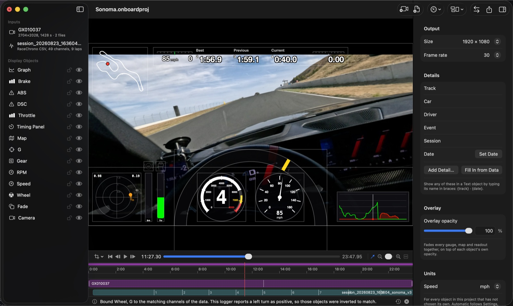

- **Sidebar (left)**: inputs (videos, data files, images) and display objects, bottom of the list
  is drawn first. Click to select and edit; the eye toggles an object; right-click to remove.
  ⌘-click or ⇧-click adds objects to the selection, and ↑ and ↓ move through the list when it has
  the focus. Click empty space below the list, or choose **Edit ▸ Deselect All** (⇧⌘A), to select
  nothing.
  Removing a video or data file keeps the objects that use it: they move to another file of the
  same kind, or wait for the next one you add, so replacing a log does not mean rebuilding the
  overlay.
- **Preview (centre)**: the composed frame at the playhead, exactly as it will export. Click an
  object to select it. A video is not picked up by a click on the picture, since it lies under
  everything else: choose it in the sidebar first, and then it can be dragged on the preview like
  any other object. Selected objects show handles; the arrow keys nudge them one pixel of the exported frame, or ten with ⇧
  held (the step is set in **Settings ▸ Editing**). With nothing selected, ← and → step a frame
  instead; `,` and `.` always step a frame, whatever is selected. **J**, **K** and **L** play
  backward, stop and play forward, each further tap faster. **I** and **O** mark a range on the
  ruler, which **Export** then offers as *In to out*; ⌥X clears it. **Playback ▸ Change Speed of
  In to Out** plays that range at 25%, 50%, 75%, 150% or 200% (or back at **Normal Speed**), and
  **Hold Frame** (⇧H) freezes the frame at the playhead for a second: picture, gauges, graphs and
  maps slow down and stand still together, with the sound muted meanwhile. Each shows as a band on
  a **Retime** lane under the ruler — "50%", "Hold 1 s" — which the timeline keeps at its length,
  so nothing else on it moves and the playhead crawls through a slowed band and pauses on a hold.
  Click one to go to it; right-click to change its speed or length, or to remove it. The export
  plays them too, and is longer by what they add. In the inspector, ↑ and ↓ raise
  and lower the number field you are in (⇧↑ and ⇧↓ select text there, as they do in any field).
- **Transport and timeline (below the preview)**: play, step, scrub. The timeline has a time
  ruler (click or drag it to scrub), a marker lane ([Markers](#markers)), a lane with one bar per video, a lane
  with one bar per data file showing where its laps fall ([Laps](#laps)), and the segment strip ([The timeline](#the-timeline)).
  Drag a video bar to move it, drag its left or right edge to trim it (the head trim keeps the
  picture where it was), click it to select the video. A click anywhere in the video or data lanes
also puts the playhead where you clicked, as in any editor. The magnet button (N) snaps drags to other
  videos' edges and the playhead; zoom with ⌘= / ⌘− / ⇧Z, the slider next to the transport, or
  scroll sideways. The thin strip above the ruler shows the whole project with a window for the
  visible part; drag it to scroll.
- **Inspector (right)**: settings for the selected input or object; drag its left edge to widen it.
  With nothing selected it shows the Getting Started checklist first, then the project's output
  size and frame rate, its details, font and camera framing; **Project ▸ Show Project Details** (⌃⌘I)
  clears the selection to get there from anywhere. **View ▸ Hide Inspector** (⌥⌘I), or the
  inspector button at the right-hand end of the toolbar, puts it away for a bigger preview and
  timeline, and brings it back; the app remembers which you chose. The window fits displays 1024 points wide. What you type in a
  text field takes effect when you press Return or leave the field, so a whole name is one step
  of Edit ▸ Undo; Escape abandons what you typed. The Edit menu says what Undo and Redo will do —
  *Undo Change Sweep*, *Redo Rename Object* — before you choose them.
- **Status line (bottom)**: what the app last did for you — chapters joined, data synced, a file
  refused. Nothing it says is lost when the next message replaces it: the clock button at its right,
  or **View ▸ Show Activity** (⌥⌘L), lists everything the app has told you in this project, newest
  first, with **Copy All** for a bug report. Errors shown in an alert are listed there too.
- **Toolbar**: Add Video, Add Data, Add Object, Layout, Sync, Export, and Inspector (show or hide it). Hover over any button without
  a caption, here or under the preview, for its name and shortcut.
- **Saving**: a project changes on disk only when you save it (**File ▸ Save**, ⌘S). Until then
  the title bar shows *Edited*, and closing the window asks whether to save — **Don't Save** leaves
  the file as you last saved it, so you can try something and walk away from it. Your changes are
  still kept aside every few seconds in a copy beside the project (*Name (Autosaved)*): if the app
  quits unexpectedly, the project reopens with them, unsaved, and the copy goes away once you save
  or discard them.
- **VoiceOver**: every control is named, and each object on the preview is an element of its own
  that VoiceOver can select and move with its actions (Move Left, Right, Up, Down).

### Videos

**Trim, sync and speed** live in the input's *Synchronization* section: *start position in file*
skips into the recording, *offset in project* delays the video on the project timeline, and *play
speed* slows or speeds it up. **Start After Previous Video** chains a clip onto the one above it in
the list; **Start at 0** resets its offset; the arrow buttons reorder inputs.

A data file has the same section. Some loggers — RaceChrono among them — time every sample by
the clock, as seconds since 1970, so the file's *start position* is a ten-digit number. The
inspector says what it is: **Time range** shows when the log ran ("Mar 14, 2026, 10:12:30 AM –
10:34:05 AM") with its **Duration** beneath, and under the start position a line gives the time of
day it stands for and how far that is from the file's first sample — or, before anything is
synchronized, the first sample's own number, which is the one to start from.

**Clip sequences.** The *Clips* section lists the files that make up one continuous video: the
recording's chapters, or any files you want played back to back. You can see the join without
opening the inspector: the sidebar row says how many files the input is (`3840×2160, 1428 s ·
2 files`) and lists them when the input is selected, and the timeline bar draws a line at each
seam, with a break where the camera was stopped between files. Chapters are joined silently
when you add or drop the first one, and further recordings added with **Add Video** join the
sequence too (the status line says so; undo or remove a clip to split it),
**Add Clips…** appends files, **Add Following Chapters** finds the camera's numbered
continuations, and the arrows reorder. Each clip has its own *In* and *Out* trim (seconds inside
that file; 0 = whole file), a *Gap before* it (black) and a *Speed* (2 = twice as fast, on top of
the input's own play speed). Trim, sync, picture settings and the
data alignment all treat the sequence as a single video, and clips may have different orientations.

Two settings shape the picture, and they answer different questions:

- **Crop** (this video, in the video inspector) is for what should never show: a visor edge, the
  bonnet, the mount. Cut any edge back with **Top**, **Bottom**, **Left** and **Right**, turn the
  picture with **Rotation** and flip it; **Reset Crop** shows the whole picture again, upright.
  To crop by eye, choose **Crop on Preview** (or **View ▸ Crop Picture**, ⇧C): the preview shows
  the whole picture with the crop over it, the cut-away parts dimmed. Drag an edge or a corner in,
  or inside to move it; **Shape** holds it to 16:9, 9:16, 4:3, Square or the picture's own shape;
  the bar also turns and flips it. **Done** keeps it as one step of Undo, **Cancel** puts it back.
  Then colour, sharpness, chroma key, and **Lens** for fisheye or 360° footage (unwrap into a flat,
  pannable view). **Audio**: include, mute, volume, balance, channel selection.
- **Frame (all videos)**, in the project inspector, chooses which part of the shot the finished
  video shows: **Zoom** in, then move the window with **Horizontal** and **Vertical** (an offset
  from the centre, as a percentage of the frame). It applies to every video at once, so every
  chapter and every camera stays framed alike without touching each one. When zoomed in, drag
  the picture itself in the preview to move the frame (the cursor becomes a hand).

  To frame it by eye, choose **View ▸ Frame Picture** (⇧T), the crop button at the left end of the
  transport, or **Frame on Preview** in the Frame section. The preview shows the whole shot with
  the overlays put away and the frame drawn over it, the rest dimmed: drag a corner in to zoom (or
  pinch, ⌥-scroll, or press **+** and **−**), drag inside it or press the arrow keys to move it.
  **Done** (Return) keeps it as one step of Undo; **Cancel** (Escape) puts it back as it was;
  **Reset** shows the whole shot. **Trim** cuts
  the same amount from every video's edges before zooming, on top of each video's own crop.
  **Reset Frame** shows the whole shot again.

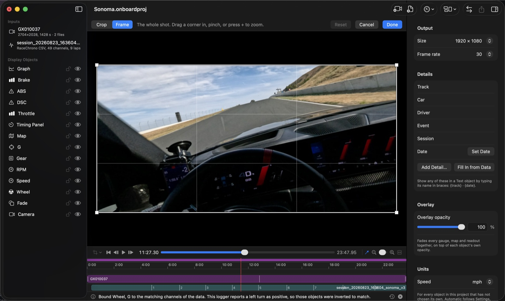

**Multiple cameras.** Add each camera as its own video input, line them up in the video lane (or
with the sync fields), then arrange them with **Layout** (picture-in-picture, split, quad) and
switch between them over time with timeline segments ([The timeline](#the-timeline)).

### Stabilisation

**Stabilisation** (in the video's inspector) steadies a shaky picture, such as from a helmet mount.
There are three ways, under **Steady**; each leaves the recording, its sync and its telemetry as they
were, and each can be undone.

#### From camera motion data

This uses the orientation the camera recorded with the video — GoPro HERO8 and later record it
with every clip. Set **Steady** to
**From camera motion data**: each frame is moved so the camera seems to follow a smooth path, so
the shake goes but turning your head or the car still comes through. **Smoothing** sets how long
the steadied view takes to follow (towards *Follow* keeps more movement, towards *Float* smooths
more); **Zoom** enlarges the picture just enough to hide the edges the moves bring into view, and
also limits how far a frame can move. Everything else — sync, the embedded GPS and telemetry, the
chapters — is unaffected, because the video file itself is not changed.

A video recorded with HyperSmooth is already steadied by the camera and cannot yet be steadied
further here; a video with no motion record (most cameras other than GoPro) says so in the
inspector.

#### From the picture

For a camera that records no motion data — most action cameras other than GoPro, phones, a dash cam
— choose **Steady ▸ From the picture ▸ Measure Motion**. Onboard Studio follows how the picture moves
from frame to frame (about thirty times a second), once per video, and steadies it from that with the
same **Smoothing** and **Zoom**. It keeps the measurement, so the video is not measured again unless
the file changes. It works best on a picture with plenty in it; blur, darkness or a plain sky make it
weaker, and it cannot tell turning from moving sideways, so prefer motion data when the camera
records it.

#### With Gyroflow

[Gyroflow](https://gyroflow.xyz) is a free app that steadies video from the camera's gyroscope,
corrects the lens and the rolling shutter, and handles footage recorded with HyperSmooth. Onboard
Studio can run it for you and show its steadied copy in place of the recording.

**Installing Gyroflow** (once):

1. Either, in Terminal: `brew install --cask gyroflow` (needs [Homebrew](https://brew.sh)), or
   download the macOS version from [gyroflow.xyz/download](https://gyroflow.xyz/download) and drag
   **Gyroflow** into your **Applications** folder.
2. Open Gyroflow once from Applications so macOS lets it run, then quit it. Onboard Studio finds it
   in Applications (or your own Applications folder) by itself; there is nothing to set up.

**Using it:** select the video, then **Stabilisation ▸ Steady ▸ With Gyroflow ▸ Stabilise with
Gyroflow**. A progress bar follows the render — it takes a while, several times the length of the
video for 2.7K or larger — and **Cancel** stops it. Gyroflow writes a steadied copy of each file of
the video beside the recording (`GX010037-gyroflow.mp4`), at the recording's own size; when the
folder cannot be written to, the copies go into Onboard Studio's Application Support folder. The
recording itself is never changed.

Only the **picture** is taken from Gyroflow's copy. Gyroflow's files lose the GPS and motion data a
GoPro records (GoPro Player's stabilised export does too), so the embedded telemetry, the camera's
clock for syncing and the chapters all keep coming from the recording — and the copy has exactly the
recording's frames and length, so the sync you set still holds. If a copy goes missing, the
recording is shown again until you choose **Stabilise Again**. Gyroflow runs as a separate program:
it is licensed under the GPL, and is not part of Onboard Studio.

### Data

Every data input shows its format, channels and laps. Its *Attributes* section says what is
mapped and how the import went, in a line, and **Map Attributes…** opens the window where a
misdetected column is fixed and every column's fate is listed (see below). *Processing* offers
resampling, smoothing, speed/heading from GPS and calculated fields (`kph = speed * 3.6`).
*Laps* come from the file when it has them, or from a start/finish line you pick on the map.

A data file is read from disk once. A large log takes a few seconds to read the first time — when
it is added to the logbook, say; making a project from that session, opening **Coach…** or
**Replay…** on it, or adding the same file to a second project then starts without that wait,
each with its own settings. Change the file on disk and it is read afresh the next time it is
opened. What was read is let go after ten minutes unused, or sooner when the Mac is short of
memory.

Supported files: RaceChrono (CSV v2/v3 and `.rcz` archives), RaceRender CSV, GPX, TCX, Garmin FIT,
NMEA, Racelogic VBO, DJI SRT, GoPro GPMF (inside the video) and generic CSV/TSV from most logging
apps. Details and column names are in [formats.md](formats.md).

#### Attributes: what your channels mean

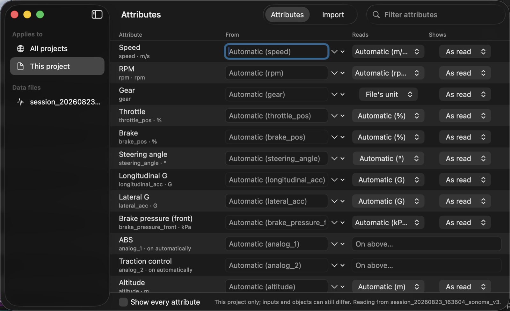

Your logger names its channels its own way. One car's ABS light is `canbus:analog_1`; the same
brake sensor is `brake_pressure_front` in a RaceChrono CSV and `66569` in the `.rcz` of the very
same session. **Attributes** are the app's names for what those numbers *mean* — Speed, Brake
pressure (front), Coolant temperature, ABS — and they are the same whatever file you opened.

**Project ▸ Map Attributes…** (⌥⌘A), or **Map Attributes…** in the data inspector or in Settings,
opens the attribute window, pointed at the data file you have selected. One row per attribute,
three columns:

| Column | What it sets |
| --- | --- |
| **From** | which column of your file feeds this attribute. Type to filter; the placeholder shows the column the app matched on its own. |
| **Reads** | what the file's numbers are in. Usually the file says, and the app shows it; set it when the file is silent or wrong. This changes how numbers are *read*, never how they are shown. |
| **Shows** | what every object displays it in. Brake pressure logged in kPa, shown in bar. Only units it can actually convert to are offered. |

An attribute that is either on or off — ABS, traction control, pit limiter — has no unit to be
shown in. Its row asks for the level it counts as on at instead, because a logger usually records
these as a raw analog channel rather than a yes or no.

The sidebar chooses who the mapping is for:

- **All projects** — set once, and every file you import afterwards follows it. This is the one to
  use for your own car: tell the app once that Brake pressure comes from `brake_pressure_front` in
  kPa and should be shown in bar.
- **This project** — where one project differs.
- **A data input** — where one file is the exception.

Each level follows the one above unless you set it, so changing the global mapping moves
everything that has not been pinned and leaves what you did pin alone. A change takes effect at
once, in projects that are already open too. A column you point an attribute at is still listed
under its own name as well, so an object's channel picker offers both *Brake pressure (front)*
and `brake_pressure_front (CAN bus)`, and objects already using the raw channel keep drawing. A single object can differ
again — see [Units on an object](#units-on-an-object).

**From the keyboard.** The window is built to be used without the mouse. **⌘F** goes to the filter
field in the toolbar. Type part of an attribute's name, or of the column it comes from, and only
the matching rows stay. A filter searches every attribute, including ones this file does not
supply. **Return** moves to the first row's *From* field; type the column and press Return again.
**Tab** walks the table in reading order: along a row, then down to the next. As you type a
column, matching columns are offered below the field; pick one with ↓ and Return. **Escape**
abandons what you typed. **⌘1** and **⌘2** switch between the attribute table and the import
report. Hover over a column title, a truncated summary or a sidebar level for a short
explanation.

The window remembers which level it was showing, which view, and whether every attribute was
listed, between launches. Without a project open it still edits *All projects*: there are no
columns to choose from then, but you can type a column's name.

#### What the import read

The attribute window's **Import** tab (⌘2, or **Project ▸ Show Import Report…**) says what became
of every column of the file, in the attribute table's own words: which ones
became channels, which of three columns called `speed` kept the role, which sensor read the same
number all session (usually one that is not connected), and which units the app did not recognise.
It shows only the columns worth a look; *Show every column* gives the rest. A file where
everything read cleanly says so in one line. The filter field searches every column by name,
group or what it became. Select rows and press **⌘C** to copy them as text, for a message to
whoever wired the logger. Without a data file the tab says so and offers **Add Data File…**.

**A file that knows where the line is.** Racelogic VBO files record the start/finish line, and
any sector gates, as actual geometry — the only format that does. Add one and the line and sectors
come with it, and the app says so rather than guessing from the trace. Opening a project you saved
earlier never changes its line, whatever the file says.

**The circuit.** Onboard Studio recognises where you were driving from the GPS trace, against a
bundled list of 1,290 motorsport venues — nothing is fetched and nothing is sent anywhere. The
*Track* section names it, says how sure it is, and lets you search for the right one if it guessed
wrong or found nothing. *Not This Circuit* clears it.

**Corners.** The map can number the corners, found from your own driving. Out of the box it
counts them 1, 2, 3 — which is not what your circuit calls them: Sonoma runs 1, 2, 3, **3a**, 4,
**4a**, and letter suffixes are normal everywhere. No public source publishes corner numbering, so
type the real names into *Corners* once and they stay with the track.

Each name stays on its own turn. A lap does not always find the same corners — a kink near the line
counts on one lap and not the next — and a name is kept where the turn is, not as "the fourth
corner", so a lap with an extra kink does not move 3a onto turn 4. A corner you leave blank among
named ones is not numbered on the map, and Coaching and Trends call it by the turns either side of
it, such as *3a–4*. Clear a name to take it off a turn.

**Save Start/Finish, Sectors and Corner Names for This Track** files them all against that
circuit. The next data file you *add* from the same place starts with them already
filled in, so you set a venue up once rather than once a session. Opening a project you saved
earlier never applies them: a project renders the way you left it, whatever the app has learned
since.

### Overlays

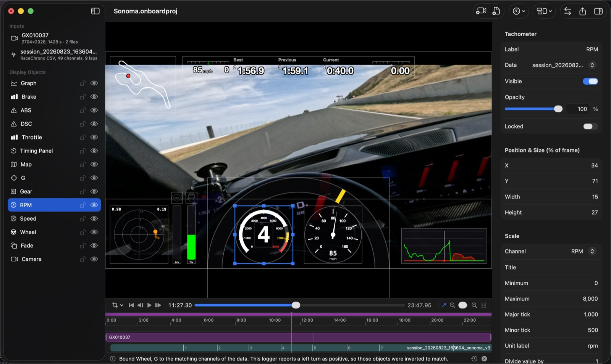

Speedometer, tachometer, custom gauge (the *Gauge Designer*: needle styles, sweep, ticks, colour
zones, face images), bar/level, 2D graph (against time, distance, the lap with a best-lap ghost, or another channel — see below),
g-force plot, track map (with a second vehicle and Apple Maps imagery), steering wheel, gear, lap counter, timers
(current/last/best lap, session, project time, time of day, delta to best), a **timing panel** (best,
previous and current lap with lap numbers plus speed-vs-best and time-vs-best lanes), a **stat card**
(the headline numbers — see below), **indicator
lights** (ABS, traction/stability, brake, warning triangle or text, lit when a channel crosses a
threshold, with hold time, flash and glow), text data with formatting and warning zones, shapes, text, images (data-driven rotation, opacity, flashing) and **Script** objects
that draw with JavaScript ([scripting.md](scripting.md)).

Wherever the inspector asks for a channel it lists the file's channels by the attribute they are —
*Lateral G*, *Brake pressure (front)* — and a channel the file named itself by that name, with
where it came from: `analog_1 (CAN bus)`. Hover over a control whose one-word label does not say
enough, such as a needle's *Tail* or *Hub*, for a short explanation.

Every slider in the inspector has a box beside it holding its exact value, in the unit shown after
it: a crop of `12` %, a smoothing of `1.5` s, a lens yaw of `-90` °. Type a value and press Return
or Tab to set it — anything past the end of the slider stops at that end — or press ↑ and ↓ in the
box to step it. Typing a value is one step to undo, as a drag of the slider is.

#### Graphs: what is coming, and one channel against another

A graph against **Time** or **Distance** shows the current moment in the **middle** of its window,
marked by a line, so the braking point you are about to reach is on the right while the corner you
have just left is on the left — the data is all loaded, so the future is known. **Now at** slides it
anywhere from the left edge (all of the window still to come) to the right edge (all of it past, as
a strip-chart recorder draws); type a percentage in its box to place it exactly, or click **Middle**
to put it back in the centre. **Line at now** turns the line off. Graphs in projects saved before
this keep drawing at the right edge, as they did.

**Horizontal axis ▸ Another channel (X-Y)** plots each series against a channel you choose instead
of time: longitudinal against lateral G for a G-G diagram, throttle against speed, brake pressure
against speed. The last *Trail* seconds are drawn as a line that fades out behind a dot at the
current moment, and the horizontal range fits the trail unless you set *Horizontal min* and *max*.
A series on its own scale keeps it here too.

Switching a bar between **Horizontal** and **Vertical** turns its frame with it, about its centre,
so a long thin bar becomes a tall thin one rather than a stub in a wide box; a frame you had
already shaped for the new direction is left as it is.

#### Stat card and the Social template

A **Stat Card** (Add Object ▸ Stat Card) puts the session's headline numbers on one card, for a clip
you share: a title — `{track} · {date}` at first, filled from the project's details — then the best
lap and its number, top speed, the optimal lap (best sectors spliced together, when the data has
sectors) and how many laps were completed. Switch *Counts* to **The lap at the playhead** and the
card follows whichever lap is playing instead: its time, how far off the best it is (or *Best lap*),
and its top speed. Each number can be turned off; top speed is in the card's own speed unit.

**New from Template ▸ Social (9:16)** lays a project out for a phone: 1080 × 1920, the whole
16:9 picture as a band across the middle rather than cropped to a sliver, a lap-following stat card
above it, and the lap timer, speedometer and track map below.

To share one lap without re-laying your project, put the playhead in it and choose **Project ▸
Export Lap as Vertical Clip…** (⇧⌘E), or right-click a marker in the sidebar and choose **Export as
Vertical Clip…** — a range marker exports its own range, a point marker the lap it falls in. The
sheet shows the stretch it will export; **Export…** writes `<project> – Lap 7 (vertical).mp4` at
1080 × 1920, laid out by the Social template, with your project's channels, units, font, frame rate
and codec. The project itself is left exactly as it was. When it finishes, **Reveal in Finder** or
**Upload to YouTube…** from the same sheet.

#### In front and behind

The sidebar lists objects front first: the one at the top is drawn over everything below it.
Select objects and choose **Arrange ▸ Bring Forward** (⌥⇧⌘F) or **Send Backward** (⌥⇧⌘B) to move
them one place, or **Bring to Front** (⇧⌘F) and **Send to Back** (⇧⌘B) to move them all the way;
the same commands are on each object's right-click menu. Or drag a row up or down the sidebar. A
group moves as one, and each change is one step of Undo.

#### Locking and grouping

A finished object can be **locked** (**Project ▸ Lock**, ⌘L, the padlock beside it in the
sidebar, or *Locked* in its inspector): it still draws and still edits in the inspector, but a
click on the preview goes straight through it to whatever is behind — the video, usually — and
the arrow keys and the delete key leave it alone. It is outlined in dashes. ⌘L again unlocks it.

⌘-click or ⇧-click objects in the sidebar (or ⇧-click them on the preview) to select several;
dragging or nudging any of them moves them all. **Project ▸ Group** (⌥⌘G) keeps them together:
a click on any member on the preview selects the whole group, which moves, resizes from one box
and nudges as one, and locks as one. Clicking a member in the sidebar selects just that object,
to edit it on its own. **Ungroup** (⇧⌥⌘G) separates them again. As in Keynote, locked objects
are unlocked before they are grouped, and a group that deleting leaves with one member stops being
a group.

Every object has a position and size in percent of the frame, opacity, mirror and an RGB mask.
Copy/paste a style between objects (**Project ▸ Copy Object Style**) or save it as an
`.onboardstyle` file. Save a whole layout as a template to reuse it on the next session (see
*Your own templates* below).

#### Your own templates

**Project ▸ Save as Template…** saves the layout — objects, fonts, segments, output size and
export settings, but not the videos, data files or the project's details — under a name, with a
picture of what is being saved. Saving under a name you already use says so and offers **Replace**.

Your templates sit beside the built-in ones in the **Templates** window (**Window ▸ Templates**,
or **Templates…** in the Logbook's New Project menu), in **File ▸ New from Template** and in the
Logbook's New Project menus, each card with a picture of its layout; click a card to start a
project with that layout. Right-click
one of yours to **Rename…**, **Duplicate**, **Show in Finder**, **Export…** it to share, or
**Delete…** it (it goes to the Trash). **File ▸ Import Template…** adds a template someone sent
you, and so does double-clicking an `.onboardtemplate` file in the Finder; it keeps the file's
name. **Project ▸ Apply Template** puts any template's layout onto the project you are in.

#### See-through overlays

Every colour in the inspectors has an opacity, every object has its own **Opacity**, and the
project inspector's **Overlay opacity** fades all gauges, maps and readouts together. For the look
of manufacturer track apps start from **Project ▸ Apply Template ▸ Glass Cockpit**: a band that
fades from clear to dark behind the instruments (any **Shape** can take a *Gradient fill*), ring
gauges with glass faces, a g-force trail, plain lap text without boxes, and a **Steering Wheel**:
a translucent rim whose yellow top-centre marker turns with the steering angle. The wheel is meant
to be wide and to hang below the frame so only its upper arc shows. It binds itself to your
logger's steering channel (any channel whose name starts with "steer", or `SWA`) and picks the
scale from its values: degrees, radians, or a −1…1 channel; **Invert direction** covers loggers
that count a right turn as negative.

**Cockpit with Graph** adds your inputs to that look. It keeps the wheel, the fade and the dials,
with the tachometer turning yellow from 6,500 rpm and red from 7,200. Across the top runs the
best / previous / current lap strip with the speed and time differences to your best lap. On the
left, the g-force trail sits beside brake and throttle bars, each with its light above it (ABS
over brake, traction over throttle). On the right, a graph traces brake and throttle over ten
seconds with now in the middle, so you see the braking point coming as well as the one just
gone. The lights find your logger's ABS and stability channels as the Indicator templates do.
The bars and graph read the **Brake** and **Throttle** attributes; if your logger only records
brake pressure, point the Brake attribute at that column in **Attributes**, or pick the channel
and range in the bar's inspector.

#### Deltas to your best lap

No script or pre-processing is needed for delta readouts. Whenever the data has laps, Onboard Studio
adds two channels that any object can use (bars, graphs, text, gauges, indicator lights, scripts):
**`lapDelta`**, the seconds you are behind (+) or ahead of (−) the session's best lap at the same
spot on the track, and **`speedDelta`**, your speed minus the best lap's speed there. Both compare
by distance travelled since the start of the lap, and the best lap is the quickest full lap of the
whole session, so the first lap already has a delta and the best lap reads zero. **Add Object ▸
Delta Bar (time)** and **Delta Bar (speed)** are ± bars that grow left or right of a zero mark in
green or red; any bar becomes one with **Fill from zero**. The Delta timer and the Timing Panel
can compare with the *session best lap* (the default), the *best lap so far* (what a live lap
timer shows) or the *previous lap*.

A Timer set to **Projected lap** shows what the lap in progress will come to if the rest of it goes
as the lap it compares with did: that lap's time plus the delta now, as a lap time (`1:32.45`),
green while it is on course to beat it and red while it is not. On the best lap it reads the best
lap's time throughout, and as a lap finishes it arrives at that lap's own time. The same number
against the session's best lap is the **`projectedLap`** channel, for a graph or a digital readout.

#### Indicator lights and your logger

Every logger names its ABS / stability / brake channels differently (a RaceChrono CAN export may
put them in `analog_1` / `analog_2`, an AiM or MoTeC file in `ABS Active` or `DSC`, a switch in
`brake_switch`). The ABS and Traction templates therefore start unbound and look through the data
input for a channel whose name mentions ABS, DSC, TCS, ESC, ESP, traction or stability; the Brake
template uses the `brake` channel when the file has one. When nothing matches the inspector says
so: pick the channel yourself. Under **Threshold** the inspector shows the channel's range in this
file ("In this file: 512 … 2800") and **Suggest** puts the threshold half way for on/off flags or
a tenth of the way up for analogue levels behind a plain light. Any channel and any level work; the
condition can be ≥, ≤, = or ≠.

The timing panel's headings, lap numbers and comparison lap (best or previous) are settings too.

#### Project details and title cards

The project inspector's **Details** say what the project is of: **Track**, **Car**, **Driver**,
**Event**, **Session** and **Date**, plus any detail of your own — *Add Detail…* and call it
*Tyres*, *Class* or *Setup*. Adding a data file fills in whatever it knows and nothing you have
typed: a RaceChrono export names its track and driver, and most loggers say which day they
recorded; a file that does not name its track takes the circuit it was recognised as.
**Fill In from Data** does the same later, for a project started before details existed.

Any **Text** object shows a detail by naming it in braces — `{track} · {date}`, `{car} on
{tyres}` — and **Insert Detail** in its inspector adds one without typing, each item saying what
it stands for now. **Add Object ▸ Title Card** starts with `{track} · {date}`. A detail with
nothing entered stays in its braces, so a title card asks for what is missing rather than
quietly leaving a gap. `{pb}`, `{pbDate}`, `{pbCar}`, `{trackDays}` and `{visits}` come from the logbook ([Personal bests](#personal-bests)), and
Insert Detail lists them under **From the Logbook**. Details belong to the project, not to templates: a template with a title
card picks up each project's own track and day.

#### Fonts

Every object that draws text has a **Font** section in its inspector: a font, a typeface within it
(*Bold*, *Condensed Medium*, …) and, for objects without a size of their own, a **Text size** from
50 % to 200 %. The font reaches all of the object's text at once — a gauge's tick labels and
readout, a timer's caption and time, a map's corner labels. Numbers stay one width in any font, so
a changing readout does not shuffle sideways.

To set one font for the whole project, choose **Project ▸ Show Project Details** and use the project
inspector's **Font** section. Objects follow it until they choose their own: their pop-up reads
*Project Font (Futura Bold)*, and choosing it again goes back to following. *Built-In* is how the
app drew before fonts could be chosen — labels in Helvetica Neue, numbers in Menlo — and is what a
project saved before this keeps.

A project opened on a Mac without its font says so under the pop-up and draws that text in the
built-in fonts rather than a substitute, until the font is installed. Copy and paste a style
(**Project ▸ Copy Object Style**) and the font goes with it.

#### Units on an object

An object shows its channel in whatever the attribute's *Shows* unit says, and a **Unit** picker
on the object overrides it for that one object — a second brake bar in psi beside one in bar, an
altitude readout in feet in a project working in metres. *Automatic* follows the attribute, and
the caption says what that currently amounts to. Only units the channel can actually be converted
into are offered, so a temperature gauge is never asked whether it would like to be in bar.

Speed keeps its own picker (mph, kph, m/s), which is what projects saved before attributes existed
already use.

With nothing chosen anywhere — the object, the project and **Settings ▸ Units ▸ Speed** all on
*Automatic* — speed is shown in the unit the data file recorded it in when that is mph or km/h. A
file that records metres per second, as RaceChrono's CSV does, is shown in your region's road unit
instead: mph in the United States and the United Kingdom, km/h everywhere else. The caption under
the picker says which it is and why. The Logbook, Trends, Coaching and Replay have no one file to
ask, so they show the unit chosen in Settings, and your region's when that is *Automatic*. Choose
m/s at any level and you still get it. A project saved before this keeps what it showed: its
speedometer goes on reading m/s, and its coaching notes km/h and metres, until you choose a unit.

A gauge or bar **added** while a data file is loaded takes its scale and unit label from what that
channel actually reads, rather than the template's 0–100 %. A brake pressure running to 1900 kPa
gets a 0–1900 kPa scale instead of a bar pinned at full all lap. Opening a saved project never
rescales anything: it renders the way you left it.

A speedometer's dial is fitted to the unit it shows as well as to the car: for a session that
reaches 130 mph it runs 0–160 in steps of 20 in miles per hour and 0–240 in kilometres per hour,
with a little room above the top speed either way. That happens when you add the speedometer, and
for a template's speedometer when its project first gets a data file, since a template is laid out
before any file is known. A dial whose scale you have set yourself is left as you set it, and so
is one in a project saved earlier: there the scale is still the 0–160 it was saved with, and
**Maximum** and the ticks in the inspector are where to change it.

### The timeline

A segment starts at a project time and changes any object's visibility, position, size or opacity
from then on; anything not changed is inherited from the previous segment. Use them for camera
switches, hiding gauges during a pit stop, or moving a map when the picture-in-picture appears.
**Add Segment at Playhead** (**⌘K**) creates one; drag its left edge to move it (later segments
follow); the inspector shows which properties the segment overrides.

#### Markers

A marker is a named point — or a stretch — worth coming back to: a braking reference, an
incident, the start of a sector.

- **M** drops one at the playhead; **⌘M** drops one and asks for its name straight away, pausing
  playback so you can type. **⇧↑** and **⇧↓** walk to the previous and next marker.
- Markers appear in the lane above the video bars and in a **Markers** list in the sidebar; click
  either to jump to one. Select one and the inspector gives it a name, a colour, a note and a
  *Length* — leave the length at 0 for a flag, or set it to draw a bar across a stretch.
- **Where a marker belongs matters.** With an input selected when you press M, the marker belongs
  to that input and is stored in *its* time, so re-syncing or re-speeding that input carries the
  marker along with it. With nothing selected it belongs to the timeline and stays at that
  timecode. The inspector says which kind you have.

#### Splitting and trimming

Select a video on the timeline and **⌘\** cuts it at the playhead (**Project ▸ Split at
Playhead**). You get two independent halves that can be trimmed, moved and re-synced separately,
and the picture runs on unbroken across the join.

A split adds a second input *and* a second camera object, with a timeline segment that swaps them
over at the cut. That is because a segment can show and hide objects but cannot change which
input an object plays — so without the extra object the second half would sit on the timeline and
never appear. Both show up in the sidebar named after the original (`Camera 2`, and so on).

**⇧[** drops everything before the playhead and **⇧]** everything after it (**Project ▸ Trim
Start / End to Playhead**). Everything here is non-destructive — the files are untouched and
**⌘Z** puts it all back.

**Data files split and trim the same way.** Select the data bar instead of a video and the same
commands apply, with the trim shown in seconds of the file in the inspector's *Trim* section.
Trimming data is applied *before* laps are worked out, so trimming an out-lap away stops it being
counted and stops it competing for the best lap — rather than leaving it in place renumbered.
Splitting data duplicates the gauges reading it, for the same reason splitting a video duplicates
the camera.

**A RaceChrono session's laps are the ones RaceChrono timed.** Lap 1 begins the first time the car
crosses the line and is a whole lap; the drive out of the pits before it is not a lap. The
session reads the same whether you add its `.rcz` archive or its CSV export. Projects saved
before this was put right keep the laps they had — the archive's lap 1 with the out-lap in it, the
CSV's lap 1 marked partial — so nothing in a finished video moves; add the data file again to
have it read afresh.

There is no separate "split at marker" or "trim to marker": jump to the marker with **⇧↑** /
**⇧↓**, which puts the playhead on it, then split or trim. That is how Resolve works too, and one
command cannot disagree with another about where the cut goes.

#### Laps

Each data file gets a bar on the timeline with a divider at every lap, numbered where there is
room. The laps come from the file's own timing, so re-syncing the data slides its laps along with
it rather than leaving them behind.

**⌥↑** and **⌥↓** jump to the previous and next lap (**Marker ▸ Previous / Next Lap**), reporting
the lap number and its time in the status line. Going back from mid-lap lands on the start of the
lap you are in, as previous-edit does in an editor; a second press goes to the one before.

Laps that fall past the end of the video cannot be reached — the timeline ends when the picture
does. The bar ends there too: a log that runs on after the camera stopped, or one chapter of a
longer recording, shows the part of the file that the picture covers, with its laps under the
times on the ruler.

#### Runs: autocross, hill climbs and stages

A circuit is timed in laps, from one line round to the same line. An autocross, a hill climb or a
rally stage is timed in **runs**, from a start line to a different finish line. Select the data
file and, under **Laps** in the inspector, set **Timing** to **Runs**. Both lines are put where the
preview is; move each with **Use Current Preview Position as Start** and **…as Finish**, or type
where it is, which way it is crossed and how wide it is. A Racelogic VBO file that recorded a start
and a finish gate is timed in runs as soon as it is added.

Runs are told apart by the car **stopping** between them, as it does when it is staged at the start
and after it slows down past the finish, so a course may pass through either line on the way round:
a run lasts from its first crossing of the start to its last crossing of the finish before the car
next stops. Each line counts only the way the course crosses it, so the drive back down a hill climb
is not a run. A run that never reached the finish is listed as **DNF**.

The inspector lists every run with its time. On the timeline the driving between runs is shaded
and unnumbered, **⌥↑** and **⌥↓** go from run to run (*Run 2 — 0:51.97*), a Timer showing the
current lap reads **RUN**, and the export sheet offers **Runs** and **Every run, one file each**
(*Autocross – Run 2.mp4*), finished runs only unless you say otherwise. Compare Laps and the Coaching
window list runs too; the fastest rolling lap is not offered, because an open course has nothing to
roll into. **Timing ▸ Laps** goes back to laps, and Edit ▸ Undo undoes either choice. The session's
entry in the Logbook follows, on its course ([Runs and courses](#runs-and-courses)).

#### Sectors

A lap split into parts tells you *where* the time went, not just how much. Select the data file
and open **Sectors** in the inspector:

- **Equal distances** (the default) cuts the fastest lap's distance into three. It needs no setup
  and works anywhere — a circuit, an autocross, a hill climb.
- **On the straights** puts each boundary on the nearest straight instead, so a sector never cuts
  a corner in half. The corners are found from your own driving; nothing here knows the venue.
- **Gates I place** uses lines you add at the preview position, crossed in the order you drive
  them.

The inspector then lists each sector's best time and the lap it came from, and the **theoretical
lap** — every sector's best added together, the lap you have already driven in pieces.

Add a **Sector Times** object to put them on the video. Finished sectors show their time and how
it compares; the sector you are in counts up in the highlight colour; the ones ahead stay blank.
**Compare with** chooses the yardstick: the best that sector was driven all session, the same
sector on your best lap, or on the lap before. Crossing the line holds the finished lap up for a few
seconds, which is the only moment its last sector can be read.

No source of sector definitions exists that this app could ship — circuits do not publish them in
any readable form, and the one dataset that has them is licensed so it cannot be used here. That
is why sectors are derived from your driving or drawn by you.

### Comparing two laps

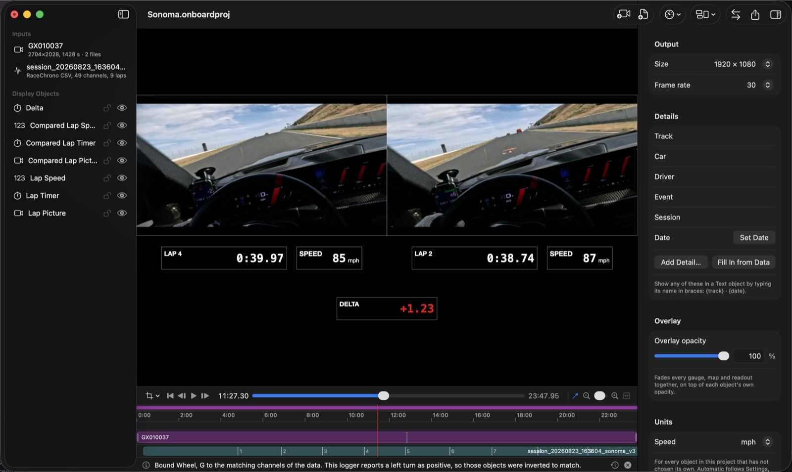

**Project ▸ Compare Laps…** plays two laps side by side, kept level by distance, so the same corner
arrives in both pictures at the same moment and you can see where one lap gained on the other. Pick
the **lap** to play and the lap to **compare with** — any complete lap of any data file in the
project, with the camera that filmed it: two laps of one session, or today's best against last
month's, or against another driver's. Choose **Side by side** or **Stacked**, then **Compare**.

The project is laid out for the comparison: each lap's picture with its lap timer and speed, and
between them a **delta** — how far ahead (−, green) or behind (+, red) the lap playing is at that
point round the track. The compared lap is slowed down or sped up moment by moment to stay level,
matched by how much of the lap each has covered, so two sessions whose GPS disagree about the lap's
length still meet at the line. The export range becomes the lap, so **Export** writes just it.

Everything in the layout is an ordinary object you can move, restyle or add to. An object's
**Shows the compared lap** (in its inspector, while comparing) switches it to the other lap; a
Timer's *Compare with* ▸ **Compared lap** measures against it. **Undo** restores the layout you
had; **Project ▸ Stop Comparing Laps** removes the compared lap and keeps the rest.

### Exporting and sharing

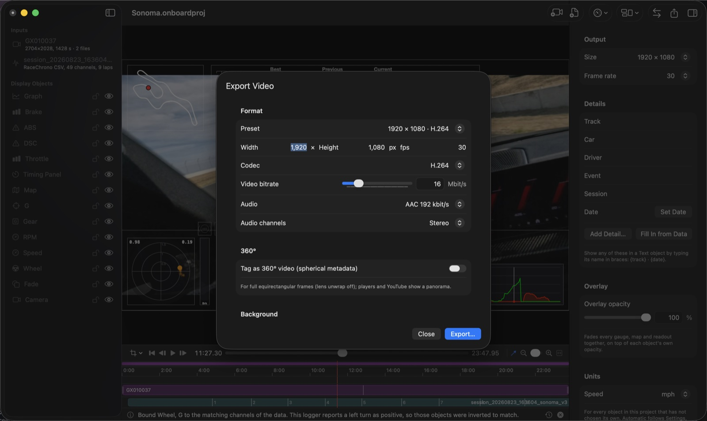

*Export* renders through the same pipeline as the preview, so what you see is what you get.
Presets cover 720p to 4K and vertical video; codecs are H.264, HEVC, HEVC with alpha and ProRes
4444 (the last two for transparent overlay-only output to composite elsewhere). *Background* can be
the video, a key colour or transparent. *360°* tags a full equirectangular frame as spherical video.

*Range*, the first thing in the sheet, exports the whole project, a time span, the range marked
with I and O, or a run of laps. **Laps** starts on your best lap: the **From** and **To** menus list
every lap with its time, the best one marked, so one lap is a single choice. Moving one end past the
other brings the other with it. The file is named after the project: its file once it is saved,
otherwise the name its window shows — for a project made from a Logbook session, the session, as
in `Sonoma Raceway, Sep 22, 2026.mp4`.

**Every lap, one file each** (in *Range*) writes each lap as its own video, into a folder you
choose, named for the project and the lap: `Sonoma – Lap 7.mp4`. *Complete laps only* (on at first)
leaves out the out-lap and the in-lap, which begin or end in the pits rather than at the line;
*Skip slow laps* leaves out cool-down and traffic laps, those slower than your best by more than the
percentage you set. The sheet says which files it will write before you start, and one progress bar
covers them all. From the command line: `onboard render --project X --laps each --out <folder>`,
with `--include-partial-laps` and `--skip-slower-than 10`.

**Every corner, one file each** writes a clip per corner of the coaching lap (the lap chosen in
Project ▸ Coaching…, else the lap being compared), each from two seconds before the brake point to
two seconds after the corner, named *Project – Turn 4*; **Only corners that lost time** keeps the
corners where time went against the reference, biggest loss first. With a Compare Laps layout and
a Corner Callout in the project that is a corner-by-corner debrief, one file per corner, from one
Export. On the command line: `onboard render --project X --out folder --corners all|opportunities`.

Two options make a corner clip teach more. **Slow the braking zone** plays each corner from its
brake point to its slowest point at 50% (or 25% or 75%), and **Hold where the reference braked**
freezes the whole frame for a second (or half a second up to three) when your lap reaches the spot
where the reference lap braked: the sight picture of where to brake. The picture and every gauge,
graph and map slow down and stand still together, and the sound is muted while they do. Both are on
for a new Every Corner export; one saved without them plays at speed. The sheet's sentence about
the files says what they will do. On the command line, add `--slow-braking 0.5` and
`--hold-reference 1` to `--corners`.

A **coaching debrief** — the corners that cost the most, as one short video between a title card
and a card of what to try next time — is under [A debrief to watch](#a-debrief-to-watch).

**Upload to YouTube** signs in with a short code and uploads with automatic resume; it needs a
one-time Google API setup described in [youtube.md](youtube.md).

## 4. Being coached

The **Coaching** window reads one lap against a reference and says where the time went: the corners
that cost the most, what happened in which phase, and what to try next time. Open it on a session
in the Logbook with **Coach…** (⌃⌘C), with no project needed, or beside a project with **Project ▸
Coaching…** (⌃⌘C).

### From the Logbook

A session in the **Logbook** is coached without a project: select it and **Coach…**. The window
reads its file and offers the same lap and reference choices (the logbook's other sessions at the
circuit among them), keeps the choices with the session, and writes the coaching sheet from
**File ▸ Export Coaching Sheet**; what needs a picture or a plan is replaced by **Make a
Project**, which opens a project from the session and brings the window to it. With a project on
the session already open, **Coach…** reads that project instead — the plan, **Show Me** on the
picture and **Compare in Video** are there, and the project comes forward behind the window — and
a Coaching window that was already reading the session offers **Use the Open Project** in place of
Make a Project; neither makes a second project of the same session. Beside **Coach…**,
**Compare With ▸** lists the logbook's other sessions at the circuit — the personal best here and
the last visit first — and opens the window with that one as the reference; **Export Coaching
Debrief…** (once the session has a clip) opens a project laid out for a debrief with the sheet up.

### The walkthrough

The window opens on a **walkthrough** that takes you through the lap one step at a time. First the lap, in
a sentence: how far behind it finished and against what (**Change…** chooses the lap, what it is
compared with and how the two are lined up). Then its three biggest losses, one corner per step:
what happened, the whole of what to try next time, **Watch**, the corner on the map with both
lines, where the time went phase by phase, and **Try this next time**, on to begin with. **Watch**
plays the corner in the window, from a moment before the brakes go on to a moment after the exit:
this lap's, then the same corner on the lap it is compared with, when that lap was filmed too (not
the spliced optimal lap, nor a lap from another session in the Logbook). From a project it plays
the project's own picture, overlays and all; from the Logbook, the clips of the session's day,
lined up by the camera's clock and the logger's. When no video covers the corner it says so. Last, **Your Plan**:
the corners you chose, as next session's experiments in the analysis's own words, which you can
edit before **Save Plan**. **Next** (Return) and **Back** (⌘[) move between the steps. The plan is
kept for the circuit, so it is there when you prepare to go back and on the Season page, and in the
project when there is one, undoably; from the Logbook it needs no project, only a circuit the
Logbook knows, and it is a step of the Logbook window's Edit ▸ Undo. **All Corners**, beside **Walkthrough** in the toolbar, shows the whole analysis at
once, as described below, and the window opens next time on whichever you used last.

### All corners

In All Corners, choose the **Lap** (it starts on the lap at the playhead)
and what it is **Compared with**: your **best lap**; the **fastest rolling lap** — the quickest
lap-length stretch of the session starting anywhere, which the timing line often cuts in two and
which is frequently quicker than any timed lap; the **optimal lap (spliced)** — the best sector of
each lap joined into one, the lap you have already shown you can do; **another lap**; or a lap of
**another data file** in the project, which is how you compare with a friend's or an instructor's
session (the two lines are matched by position, so a different line through a corner still meets
the same corner); or, when the logbook has other sessions at this circuit, a **Logbook** session —
**Personal best here**, **Last visit**, or any by date and car — read in on demand without adding
its file to the project. Two laps of one session are matched metre for metre, which is right when they
follow the same line; when you drove a corner two different ways on purpose, turn on **Line up by
position** and they are matched by where the car was instead (undoable, saved with the project).

The headline says how far behind the lap finished. Below it the **top three opportunities** are
cards, their advice in full: which turn, how much time and in which phase (braking, entry, apex or exit), what happened
("Braked 22 m earlier than your best lap", "Minimum speed 4 km/h lower, 12 m later", "Coasted
0.49 s longer") and what to try next time, phrased as an experiment. A corner you drive
differently every lap is told so, and asked for the same brake point first. **Show Me** puts the
playhead where that corner's braking began on the lap being read, so the preview shows it.

Every corner is in the table below, sortable by any column: time lost, the phase, and how the
brake point, minimum speed and where it fell, exit speed and throttle pick-up compare with the
reference, plus whether the corner is consistent across your flying laps (the spread of brake
points in brackets). Selecting a row moves the playhead to that corner's turn-in and opens the
corner's **detail** beside the table: the time lost in each phase as bars, both laps' readings
side by side (brake point, peak braking, where the brakes came off, trail braking, entry and
minimum and exit speed, where the slowest point fell, throttle pick-up, full throttle, coasting,
peak lateral G, time in corner) with where each reading came from, and the two lines through the
corner drawn from GPS with the brake points and slowest points marked — a relative picture, since
lap-to-lap spread is about a metre and absolute accuracy one to three. **Compare in Video**, beside
the corner's name, lays
the project out as Compare Laps does, with both laps' pictures, over that corner only: the
playhead goes to the brake point and the export range is the corner, so one export is the clip.
It is offered when the reference is a real lap with a camera; the rolling and spliced laps are
data only.

### Traffic and flags

A corner where another car held you up, or that you drove under a yellow flag, says nothing
about how you drive, so mark it and the coaching leaves it out. On the corner's step of the
walkthrough choose **Leave This Corner Out ▸ Held Up by Traffic** or **Under a Flag**; in All
Corners right-click its row (**Mark Turn 4 as Traffic**, **Mark Turn 4 as a Flag**, **Clear
Traffic Mark**), or use the mark at the top of the corner's detail. A marked corner:

- is never an opportunity, gets no advice, and is listed under the walkthrough's first step as
  left out; the table reads *traffic* or *flag* in its Phase column;
- still counts in the lap's total, which says how much of it was traffic ("2.40 s behind, 1.80 s
  of it held up by traffic");
- is left out of that corner's consistency — the rest of the lap still counts, and a lap slowed
  past the flying-lap limit only by its marked corners counts too, though its lap time is left
  out of the lap-time spread;
- makes a lap a poor default: with no lap chosen the window reads the quickest lap no mark
  touches;
- reads "Turn 4: held up by traffic" on a Corner Callout, and is skipped by the Coaching Debrief
  and by **Only corners that lost time** when exporting one file per corner.

The mark covers the stretch of the session the corner was read over, so it applies whatever the
lap is compared with; when the compared lap is from the same session and was held up there
itself, the corner is left out too, and its detail says so. Marks are kept with the project's
coaching choices (or with the session, from the Logbook), and each one is an undo step. A project
with no marks reads exactly as it did. `onboard coach --traffic 312.5-330,1204-1215:flag` does the
same from the command line, in seconds of the data file.

### A plan for next session

**Next session.** Under the opportunities, **Make a Plan** writes up to three experiments for next
time, one per corner that cost the most, in the window's own words; edit any line to say it your
way (Return or leaving the field keeps it), **Add Experiment** adds a line for the lap as a whole,
the minus removes one, **Start Over** rewrites the plan from the current opportunities. The plan is
saved with the project and, when the circuit is recognised, remembered for the circuit in its
track definition — so the next project at the same circuit opens the Coaching window with **Last
time at Sonoma you planned to try…** and **Use It Again**. Every step is one undo (*Undo Make
Plan*, *Undo Edit Plan*, *Undo Remove Experiment*). The circuit's card in the Logbook shows the
plan again before you go back, and changes it too.

### On paper

**On paper.** While the Coaching window is in front with a lap read, **File ▸ Export Coaching
Sheet as PDF…** writes the debrief on one page — the track and the day, the headline, the circuit
with every corner numbered, the top opportunities with their evidence and what to try, every
corner's numbers, and the next-session plan — black on white, for printing or handing to an
instructor; **File ▸ Export Coaching Sheet as Markdown…** writes the same as text for a message or
a notes app. Files are named for the track and the lap (`Sonoma – Lap 2 coaching sheet.pdf`).
`onboard coach … --markdown` prints the Markdown from the command line.

### What the analysis reads

When the data file has no brake or throttle channel (a GoPro, a phone), the brake and throttle
points are read from the speed trace and the window says so. Notes are in mph and feet when the
app's speed unit is mph — chosen in Settings, or your region's when Settings say *Automatic* — and
in km/h and metres otherwise. The lap and reference you chose are saved with the
project; changing them is undoable. The method, its thresholds and the research behind it are in
[coaching.md](coaching.md); `onboard coach` does the same from the command line ([Command line](#8-command-line)).

### In the video

**In the video.** Add a **Corner Callout** object (toolbar ▸ Add Object ▸ Corner Callout) and the
rendered lap carries its own debrief: as the car approaches each corner the card appears with that
corner's headline ("Turn 4: 0.31 s lost on entry"), the evidence and what to try, stays through
the corner and a moment after, and is blank on the straights. It reads the lap being driven
against the reference chosen in Project ▸ Coaching… (your best lap until you choose one), so a
rendered session comments on every lap, not only the one the window shows. The inspector sets how
early it appears and how long it stays, whether to show the evidence and the suggestion, whether to
keep quiet on corners where no time was lost, and the colours. Notes follow the object's speed unit.

The **Track Map** has a Coaching section too, all off until you turn them on: the **reference
lap's line** drawn dashed beside the outline, so a different line through a corner shows; the lap
being driven **coloured by time gained and lost** against the reference (red where the gap grew,
green where it closed, the plain outline where it held); **brake points and slowest points** as a
circle and a square for both laps; **Follow the corner in play**, which frames the map on the
corner from its brake point to its exit and shows the whole circuit on the straights; and **Every
lap's line, the quickest brighter**, which draws every other complete lap of the session faintly
under the outline with the quickest of them at full strength — the spread of lines through each
corner, and the one that worked, seen rather than inferred. They read the same reference as the
callout. The Coaching window's corner detail draws the other laps' lines through the corner too.

A lap-axis **Graph** can draw the coaching reference as its ghost instead of the session's best
lap (Ghost ▸ Coaching reference): the fastest rolling lap, the spliced optimal lap or another
driver's lap behind the live trace. A channel the reference does not carry draws no ghost.

**Compare Laps** can put the **fastest rolling lap** or the **optimal lap (spliced)** beside a lap
as a picture: choose it where the compared lap is chosen, or press Compare in Video in the Coaching
window with that reference. The picture is cut from the laps it came from, kept level with the lap
playing, so it jumps at each join; its readouts show the lap it is in at that moment. This is the
lap you have already driven in pieces, watched as one.

### A debrief to watch

**Export Coaching Debrief…** (Project menu) writes the session as one short video to watch
before the next one: a title card with the track, the day, the best lap, the optimal lap and the
fastest rolling lap; then the corners of the coaching lap that cost the most against the reference
(three at first; **Corners** sets how many), biggest loss first, each as a clip in your project's
own layout from two seconds before the brake point to two seconds after the corner; then a closing
card, *Next session, try…*, with one experiment per corner from the Coaching window's notes. The
sheet lists the pieces and the running time before you start; one progress bar covers them all,
and the pieces are joined into `<project> – Coaching Debrief.mp4` in the project's size and codec.
**Project ▸ Apply Template ▸ Coaching Debrief** gives the clips a Corner Callout, a track map that
follows the corner with the reference line and both brake points, the lap timer, the delta and the
speed; a Compare Laps layout gives them both laps' pictures. **Read the notes aloud** has the
system voice read the title card, each corner's headline and what to try over its clip, and the
plan on the closing card; the cards stay up as long as the words take and the clips' own sound
comes down while the voice speaks. The project itself is not changed. From the command line:
`onboard render --project X --out debrief.mp4 --debrief` (`--narrate` for the voice).

For a clip of every corner instead, slowed through the braking zone and holding the sight picture
where the reference braked, use **Every corner, one file each** in the export sheet
([Exporting and sharing](#exporting-and-sharing)).

### Replay: your laps in 3D

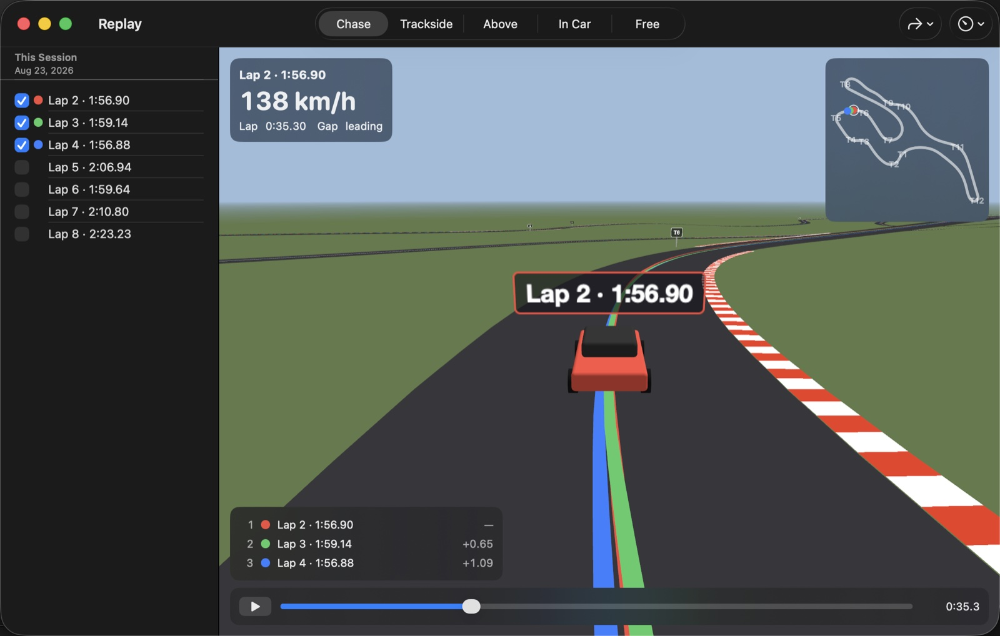

Select a session in the **Logbook** and **Replay…** (or **Window ▸ Replay**, ⌃⌘R, for the
project in front; or **Replay** in the Coaching window's toolbar). The circuit is drawn as a road
with kerbs over the elevation your logger recorded, from the session's own GPS — nothing comes
from a map, and a logger without altitude gets a flat road. The session's three quickest laps
start together, each painted on the tarmac in its own colour with a car and its name; the list
on the left offers every complete lap and, under their own headings, the logbook's other
sessions at the circuit — tick one and its lap joins the race.

**Play** (Space) and the cars go. The standings at the bottom left give each car's place and gap
to the leader; click a car to follow it. The HUD reads the followed car's speed, lap time and
gap; the map at the top right shows where everyone is. The cameras in the toolbar: **Chase**
behind the car, **Trackside** from a post beside the track, **Above** straight down, **In Car**,
and **Free** (drag to orbit, scroll or pinch to zoom; keys 1–5). **Go to Turn ▸** jumps to just
before a corner, the scrubber and ← → step through the lap, **Speed** slows or quickens the
replay.

## 5. Your progress

Every session in the Logbook counts towards these; nothing has to be set up. They are views of the
Logbook: **View ▸ Sessions**, **Trends** and **Season** (⌘1, ⌘2, ⌘3), or the switch in its toolbar.

### Personal bests

The **PB** column, the table's first so a narrow table keeps it in view, marks every session that
set a personal best at its circuit when it was driven, overall or in its car: a filled yellow star
on the session that holds it now, a hollow star on one that has since been beaten, so a run of
improving sessions reads as progress and one star still says which is the best. A selected
session's **Personal best here** says the best at that circuit, when, in what, and how many visits
you have had — track days, however many sessions each.

In a project, a Text object or Title Card can show `{pb}`, `{pbDate}`, `{pbCar}`, `{trackDays}`
(how many track days) and `{visits}` (how many sessions) for the circuit its data is at — **Insert
Detail ▸ From the Logbook** offers them — (in the project's car when the logbook has one there), and
a Timer's *Delta* or *Projected lap* can **Compare with ▸ Personal best (logbook)** — the gap to
your personal best lap at the same distance, that session read on demand, the session best when the
logbook has nothing to offer.

### Trends

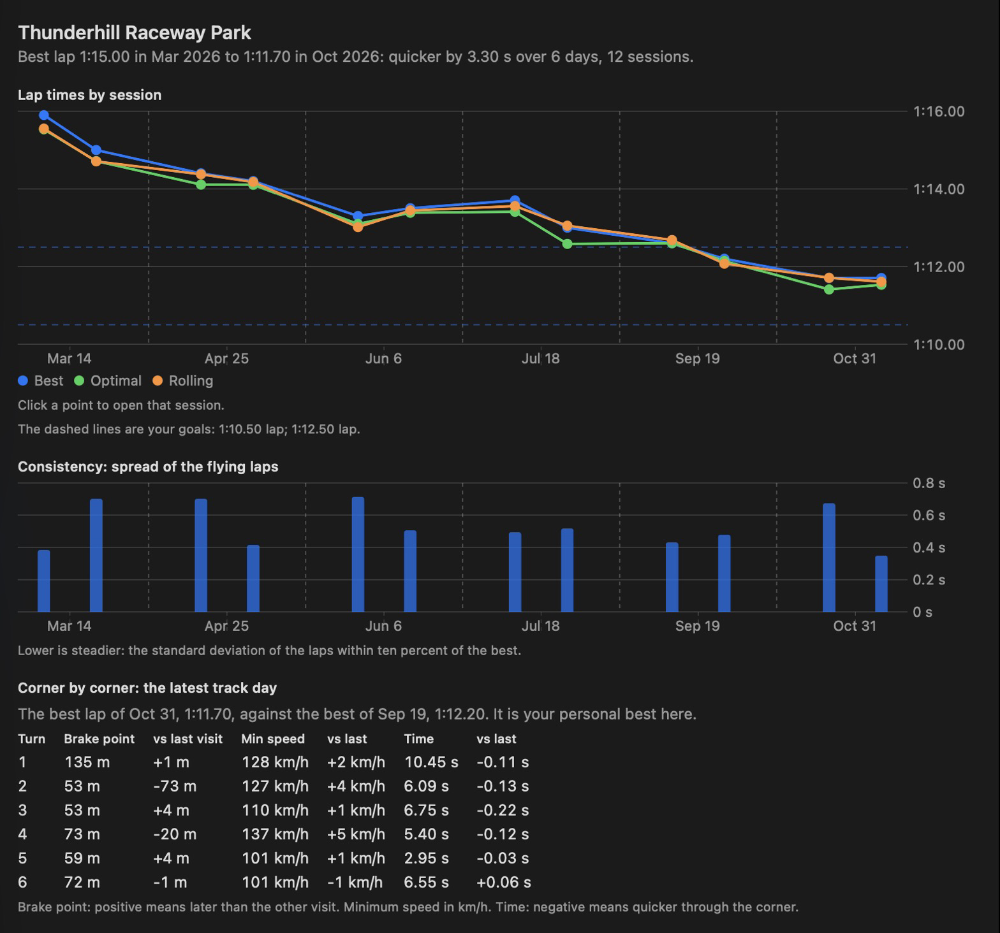

**Trends** (with a circuit chosen in the sidebar) answers whether you are getting quicker: a chart
of the best, optimal and fastest rolling lap of every session with a sentence on how far the best
moved from your first day there to your last, narrowed to one car when you have more than one there;
each session's spread of flying laps as consistency. Both charts space the sessions evenly in the
order you drove them, grouped by track day with the date under each day and a dashed line between
days, so six sessions in one day read as clearly as visits months apart. A lap-time
[goal](#goals) is drawn as a dashed line on the lap chart, a consistency goal on the consistency
chart. Click a point to open that session.

Below the charts, corner by corner, the best lap of your latest track day against the best of the
track day before and against your personal best — brake point, minimum speed and time in the
corner. Minimum speed is in the app's speed unit, and brake points are in feet when that is mph
and in metres otherwise, as Coaching gives them; the line under the table names both. A line
above the table names the laps it reads, and a comparison's columns appear only when there is one
to make: none against the personal best when the latest day set it. Sessions entered before
corners were kept offer **Read Their Corners**, as do sessions whose corners were measured before
a correction to how the app measures them (#438), so a fixed reading reaches sessions already in
the logbook.

### Car against car

With two cars at the circuit, **Car against car** at the foot of Trends reads each car's best lap
against the other's: which is quicker and by how much, both speed traces over distance, and a
sentence per corner naming the car — where one brakes later, carries more speed through the apex
or leaves faster.

### The season

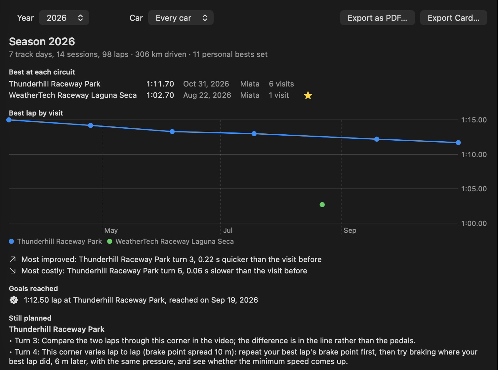

**Season** sums a year up — pick the year and, with more than one car, the car: track days,
sessions, laps and kilometres; personal bests set; the best at each circuit with its date, car and
visits (track days), starred when it was new; a chart of every circuit's best of each track day; the
most improved and the most costly corner against the track day before; the goals reached that year;
and the plans still open at the circuits you visited. **Export as PDF…** for paper (the goals
reached are in it too), **Export Card…** for a 1080 × 1920 picture to post.

## 6. Before you go back

Before you go back to a circuit, choose it under **Circuits** in the Logbook's sidebar. Its card,
above its sessions, gathers what to take with you.

### The circuit's card

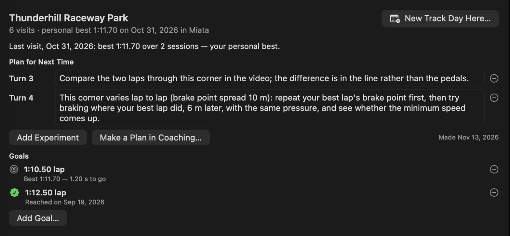

The card says how many visits you have made, your personal best there (when, and in what car) and
how your last visit went against it. Under **Plan for Next Time** is the plan you made in the
Coaching window for that circuit ([A plan for next session](#a-plan-for-next-session)) — each line
can be changed right there, **Add Experiment** adds one and the minus removes one. With no plan
yet, **Start a Plan** begins one from **Where the Last Visit Lost Time** — the corners where your
last visit's best session was slowest against your best lap, with how much and whether you braked
earlier or were slower at the apex — and **Make a Plan in Coaching…** opens Coaching on that session
to write one from its laps; the plan saved there is on the card at once. Each change, the one made
in Coaching too, is one step of the Logbook's Edit ▸ Undo.

**New Track Day Here…** begins the next day at the circuit, and that day shows the same card until
its first session arrives. A plan is kept with a circuit the catalogue knows; for a circuit named by
hand the card says so.

### Goals

**Goals** are on the same card. **Add Goal…** sets what you are aiming for at the circuit: a **lap
time**, **consistency** (your flying laps within so many seconds of each other in one session), or
**a corner** — the time through it, or the speed at its apex, on a session's best lap — in any car
or one, and by a date if you like. Each goal says how far there is to go (*Best 1:42.31 — 2.31 s to
go*) or the day it was reached; the minus removes it, and Edit ▸ Undo brings it back.

A goal is followed wherever the circuit's laps are: a lap-time goal is a dashed line on the
circuit's **Trends** chart and a consistency goal on its consistency chart; when you add a day's
files, the report says which goals the new sessions reached, or how much closer they came; and the
**Season** lists the goals reached that year, on the page and in its PDF.

## 7. Coming back

Back from the next day, the same steps close the loop:

1. **Begin the day** with **New Track Day Here…** on the circuit's card, which names the circuit for
   you — or skip it, and **Add Files…** with no day chosen puts each file on the day its date and
   circuit say, with the car of your last session there.
2. **Add the day's files.** The sheet says how the day went against your last visit — *0.84 s
   quicker than your last visit (12 Oct) — a personal best* — and which goals the new sessions
   reached or how much closer they came ([What the import says](#what-the-import-says)).
3. **Show Trends**, beside Done, opens the circuit's Trends with the new day on it: its best,
   optimal and rolling lap among the others and, corner by corner, its best lap against the day
   before and your personal best — so the corners in your plan can be checked
   ([Trends](#trends)).
4. **Coach…** the new session, or **Compare With ▸** to read it against the last visit or your
   personal best there. The walkthrough's **Your Plan** becomes the plan for the visit after
   ([Being coached](#4-being-coached)).
5. **New Project** lays the session out with the template you used last time; export the best lap,
   every lap, every corner or a debrief ([Making a video](#3-making-a-video)).

At the end of the year, the **Season** sums it up ([The season](#the-season)).

## 8. Command line

`onboard` does the same work without the app: `probe` inspects a data file, `coach` reads one
lap against another and says where the time went, `render` exports a project, `sync` finds the
data/video offset from motion, `logbook` keeps the logbook of track days, `upload` sends a file to
YouTube and `bench` measures speed. See
[testing.md](testing.md).

`onboard coach session.csv` reads the quickest lap that is not the best against the best lap:
the top three corners by time lost, each with what happened ("Braked 22 m earlier than your best
lap", "Coasted 0.49 s longer") and what to try, then every corner in a table with its brake point,
minimum speed, exit speed and throttle against the reference, and whether the corner is driven
consistently across the session. `--lap 5` picks the lap; `--reference rolling` compares with the
fastest rolling lap (the quickest lap-length stretch starting anywhere, which often beats the best
timed lap), `--reference optimal` with the best sectors spliced together, `--reference lap:6` with
another lap; `--units imperial` writes the notes in mph and feet; `--json` prints everything as
data. A project works too: `onboard coach my.onboardproj` reads its first data input, with the
sectors, corner names and traffic marks the project has. `--traffic 312.5-330,1204-1215:flag` marks
stretches as held up by traffic (or `:flag`) in seconds of the data file, and the corners they cover
are left out of the coaching ([Traffic and flags](#traffic-and-flags)). The method is in
[coaching.md](coaching.md).

**The logbook.** `onboard logbook new-day --date 2026-08-23 --circuit Sonoma --car Miata` begins a
day, `onboard logbook add <files or folders> --day <id or date>` puts files on it (`--car`,
`--driver`; without `--day`, each file goes on the day its date and circuit say; with it, every
file goes on that day and the line of one dated otherwise says so), `onboard logbook days` lists
the days and `onboard logbook list` the sessions with their day. `onboard logbook export
<folder|.csv|.md>` and `onboard logbook import` take it with you.

## 9. Troubleshooting

- **Reporting a problem.** **Help ▸ Export Diagnostics…** saves one zip for a bug report: the
  app's log since it started, everything it told you, the open project's settings and file paths,
  a description of each data file (channels, units, ranges, laps — not the data itself), which
  ffmpeg it found, and any crash report from the last two weeks. No videos or data go in, and the
  app sends nothing: you choose where it is saved and whom to give it to. After a crash, the app
  offers to make one when it next starts.

- **Something happened and the message is gone.** **View ▸ Show Activity** (⌥⌘L) lists every
  message and error since the project opened; **Copy All** puts them on the clipboard.

- **The gauges lead or lag the picture.** Open **Sync** and nudge while watching a braking point.
  The panel stays out of the way under the preview, so you can scrub, look and nudge in a loop;
  the **−1f / +1f** buttons move by a single frame, which is finer than a tenth of a second at
  every normal frame rate. You can move the video against the data as well as the data against
  the video. Or run Auto-Sync by Motion. GoPro creation times can be tens of
  seconds off, which is why the GPS clock is preferred when the clip has one.
- **The data was not synced from timestamps when I added it.** The status line (and **View ▸
  Show Activity**) says why. *The video's file creation time puts it 1 day, 16 hours before the
  log starts* means the camera's clock is wrong; Onboard Studio has synced by motion instead. To
  get timestamp sync back, turn GPS on in the camera or let GoPro Quik set its clock.
- **A GoPro clip appears upside down.** Onboard Studio honours the camera's orientation flag; use
  Rotation 180° in the Picture section if the camera was mounted inverted without setting it.
- **Stabilisation does little, or nothing.** Choose the method the camera supports: *From camera
  motion data* needs a GoPro HERO8 or later recorded with HyperSmooth off; otherwise use *From the
  picture* or *With Gyroflow*. A shot that is mostly deliberate movement (looking around in the
  pits) has little shake to take out. More **Smoothing** steadies more; if edges show, raise **Zoom**.
- **Gyroflow is not found.** Install it into Applications (see *Stabilisation ▸ With Gyroflow*), open it
  once, then choose *With Gyroflow* again; the inspector checks each time it is shown.
- **The steadied picture disappeared.** A Gyroflow copy was moved or deleted, so the recording is
  shown; choose **Stabilise Again**.
- **A file will not open.** MTS, MKV and some AVI files need `ffmpeg` installed
  (`brew install ffmpeg`); Onboard Studio converts them on first use.
- **Missing media after moving files.** The sidebar marks the input; select it and press
  **Relink…**.
- **An export is slow.** `onboard bench --export` reports the speed; on Apple silicon 4K HEVC
  runs at about twice real time. Large scripted objects and 4K map backgrounds cost the most.
- **A session went on the wrong day.** Select it (or several) and choose **Session ▸ Move to Day**,
  or drag it onto the day in the Logbook's sidebar; ⌘Z puts it back. A camera or logger with its
  clock wrong is the usual cause: **Add to This Day** in the import sheet puts such files on the day
  you chose.
- **One car is spelt two ways.** Choose either under **Cars** in the sidebar, **Rename…**, and type
  the other's name: they become one car, with both cars' notes.
- **A clip is on no session.** Its row under **Clips** in the day's header says it overlaps none;
  the pop-up beside it says whose it is.
- **A session has no personal best or Trends.** It names no circuit and is listed under **No
  circuit** in the sidebar: name its day's circuit in the day's header.
- **A line above the sessions offers Read Them Again.** Those sessions were added before a
  correction to how laps are read and keep the laps they were read with; Read Them Again reads
  their files afresh and leaves the car, driver, conditions and notes alone.
